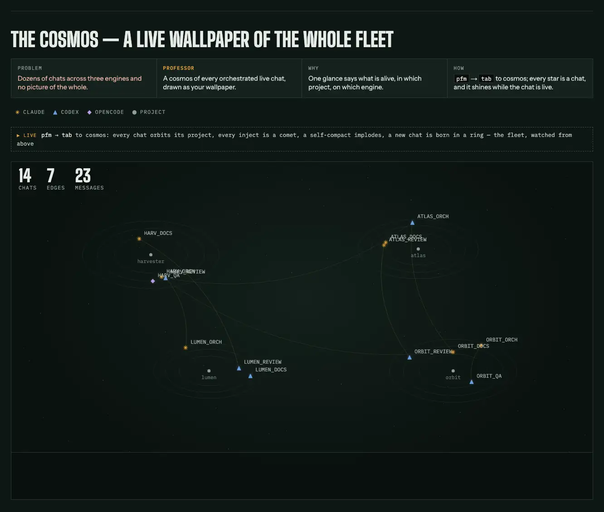
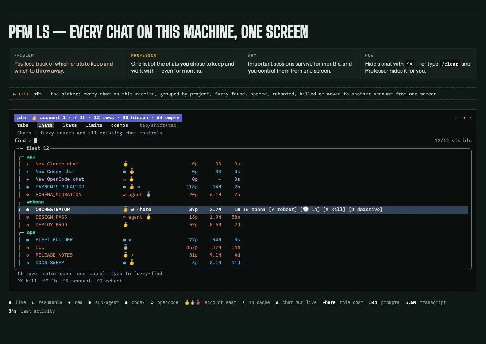
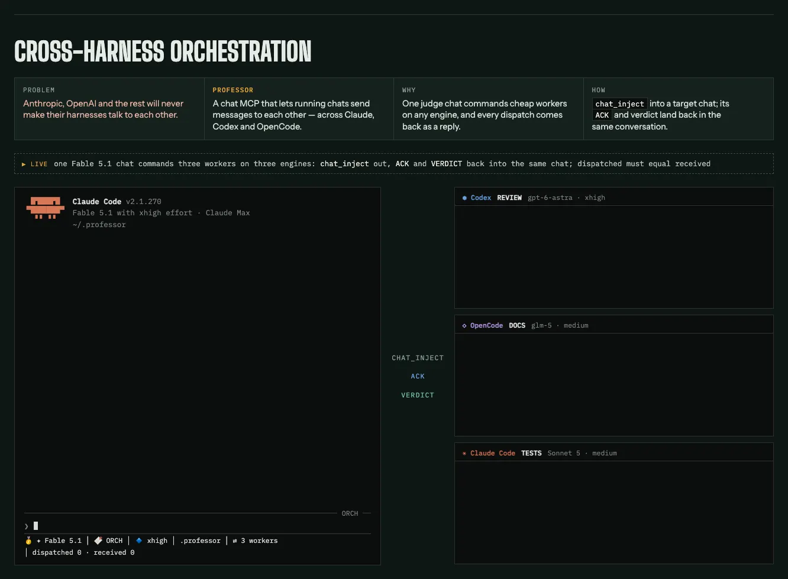
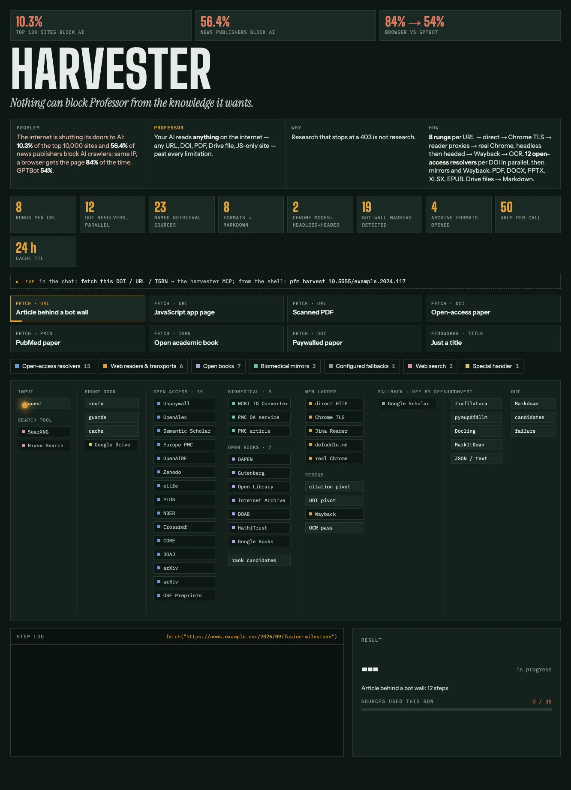
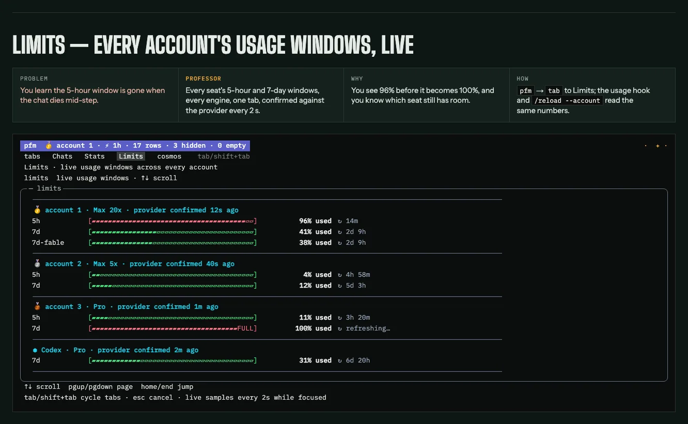
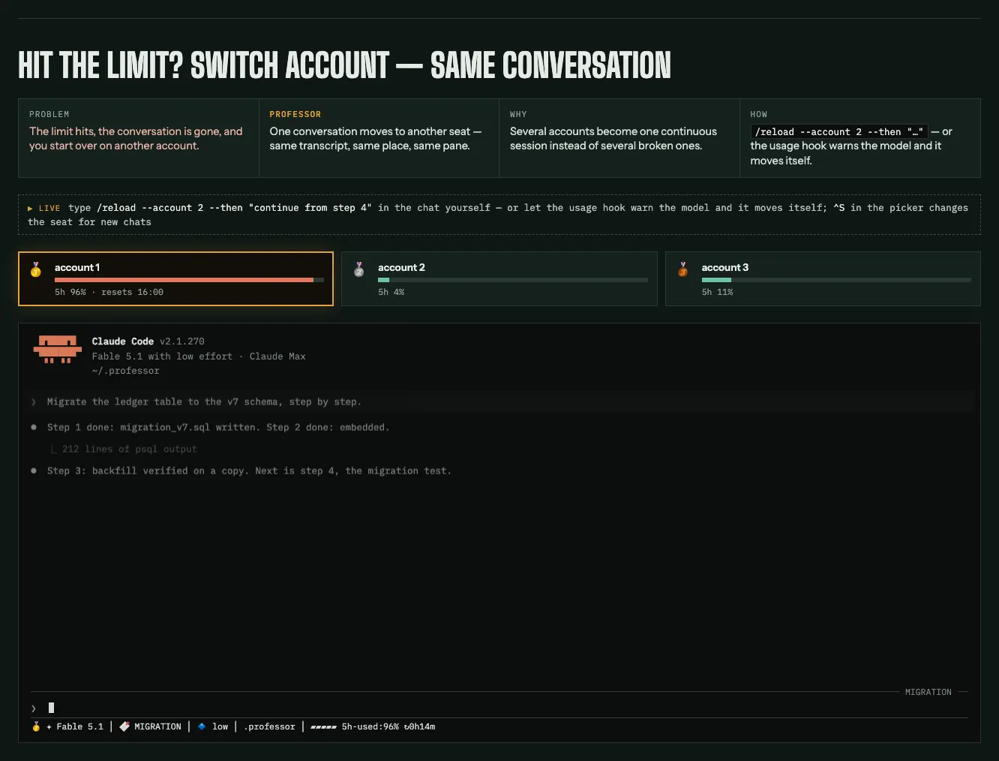

<h1 align="center">Professor</h1>

## Contents

- [Why Professor?](#why-professor)
- [Six things you can watch it do](#six-things-you-can-watch-it-do)
  - [1. See the fleet](#1-see-the-fleet)
  - [2. Chats that talk to each other](#2-chats-that-talk-to-each-other)
  - [3. Rules that bite](#3-rules-that-bite)
  - [4. Read what the web hides from bots](#4-read-what-the-web-hides-from-bots)
  - [5. One contract, three runtimes](#5-one-contract-three-runtimes)
  - [6. Reload without losing the conversation](#6-reload-without-losing-the-conversation)
- [Install](#install)
- [The discipline layer (`templates/`)](#the-discipline-layer-templates)
- [The fleet CLI (`pfm/`)](#the-fleet-cli-pfm)
- [Plugins](#plugins)
- [Origin](#origin)
- [Help and community](#help-and-community)
- [Contributing](#contributing)
- [License](#license)

<p align="center">
  <strong>Multi-agent framework for Claude Code, Codex &amp; OpenCode.</strong><br>
  Turns the AI coding chats on your machine into a disciplined engineering team —<br>
  one you can see, message, and hold to the rules.
</p>

<p align="center">
  <a href="https://github.com/rezzminator/professor/releases"></a>
  <a href="LICENSE"></a>
  
  
  
</p>

<p align="center">
  <a href="#six-things-you-can-watch-it-do">Watch it work</a> ·
  <a href="#install">Install</a> ·
  <a href="#the-discipline-layer-templates">Discipline layer</a> ·
  <a href="#the-fleet-cli-pfm">Fleet CLI</a>
</p>

<p align="center">
  
</p>

<h2 align="center">Professor is a complete, integrated toolbox for everything you want to do — that Anthropic, OpenAI <em>or anyone else</em> will <em>never</em> give you.</h2>

A fleet controller and a discipline layer for **Claude Code, Codex, and OpenCode** — chats that talk to each other, agents that follow the rules, and a harvester that reads what the web won't show a bot.

## Why Professor?

You already run more than one AI chat. They cannot see each other, they forget the rules the moment context compacts, and a growing share of the web answers them with a 403. Professor is the layer that fixes all three — without touching what your harness is, only what it does.

| | Without Professor | With Professor |
| --- | --- | --- |
| Many chats, many accounts | Scattered terminal tabs; a closed tab is a lost chat | One picker — every chat on every harness, live or resumable |
| One chat needs another | You copy-paste between windows | `pfm chat call` — a signed turn, delivered and acknowledged |
| The rules, after compaction | Whatever the prompt still remembers | Hooks that refuse, naming the right way in the refusal |
| A bot-blocked page | A 403, or an empty page reported as content | A seven-rung fetch ladder; a block is reported as a block |
| Claude and Codex rules | Two files that drift apart | One `CLAUDE.md`, compiled mirrors, drift fails the check |
| An account hits its limit | Start over in a new chat | `/reload --account 2` — same pane, same history |

---

## Six things you can watch it do

Every transcript below is real output from this repository, redacted only of names.

### 1. See the fleet

<p align="center">
  
</p>

> `pfm ls`: every AI chat on the machine — Claude Code, Codex (⬢), and OpenCode — across accounts (🥇🥈), grouped by repo, live (●), resumable (↻), or agent-run (⚙). `⇄` marks chats that talk to other chats; `←here` is the one you are sitting in; `✦` opens a new one on any harness. Pick one, attach, or fire it a goal without ever attaching. A chat that scrolled off a closed terminal tab is not gone — it is a resumable transcript, and now somebody can find it.

`tab` once more and the same fleet is drawn as the sky at the top of this page.

> Every project is a star its chats orbit; a spawned chat rises as a moon at its parent's angle, so lineage is visible in the sky itself. When chats talk to each other the sky draws an edge between them, read from a durable comms ledger — an edge is a fact, not a guess. The chronoscope replays the last 24h, and a chat that is dead now still renders as the ghost it was back then.

### 2. Chats that talk to each other

Two panes, two harnesses. You type one line into the Claude chat on the left; the Codex chat on the right receives it as a signed turn and gets to work.

<p align="center">
  
</p>

> The footer on the Codex side is the signature: who spoke (`sid 0a98b7fe`) and the exact command to answer them. A message no sender could be derived for is refused, never delivered anonymously.

`pfm chat call` is what the Claude chat called — it types a real, signed turn into another chat's pane — under a per-target lock, safe against a busy target (`--force-now`) and shell-hostile payloads (`--file`). `pfm chat ask` waits for the answer, with named exit codes: `0 done · 2 usage · 3 chat dead · 4 no such chat · 5 answer timed out · 6 message not delivered · 7 answered, but another message reached the chat mid-wait`. The chat family is registered as `chat-professor`, with bare MCP tool names such as `call` and `ls`, so an agent can spawn, message, read, and retire other chats across all three harnesses.

### 3. Rules that bite

A subagent tries to run `git commit`. The `git-guard` PreToolUse hook answers:

```text
git-guard blocked `git commit -m wip`.
Only gitter writes this: spawn Agent(subagent_type: "gitter") with the repo path and the exact change.
```

The refusal names the right way. That is one of the mandatory rules every install ships with: only `gitter` writes git; framework edits go through the `pcm` agent; and **an error never renders as ABSENCE** — "we failed to look" is never shown as "nothing there".

### 4. Read what the web hides from bots

About one in ten of the world's top 10,000 websites now tells AI crawlers to stay out — among news publishers, more than half (HasData AI Crawler Block Index, July 2026). Harvester fetches the way a reader's browser does and climbs a seven-rung ladder — direct → Chrome-fingerprint TLS → reader proxy → extractor → headless-then-headed browser → Wayback → OCR — until it holds real content:

<p align="center">
  
</p>

A block is reported as a block and an app shell is never stored as the page — a failure names every source it checked, never an empty success. DOIs, ISBNs, PMIDs and PMCIDs route through twelve open-access resolvers in parallel; `harvester ask -p "…" <sources>` feeds the full cached artifacts to a Claude or Codex ask engine, failed sources kept visible as receipts. Harvester is a standalone Go plugin in `plugins/harvester/`. Its native engine plugins register the `harvester` MCP server and launch `harvester mcp` as a stdio proxy to the persistent daemon; the [plugin guide](plugins/harvester/README.md) lists each engine's measured tool names and install route. The browser rung never solves anything interactive.

### 5. One contract, three runtimes

```text
$ engine-sync codex build .
$ head -1 AGENTS.md
<!-- Generated by engine-sync from CLAUDE.md — edit the source, then run: engine-sync build -->
$ engine-sync codex check .
CODEX CHECK PASS
```

`CLAUDE.md` compiles to `AGENTS.md`; `.claude/**` compiles to `.codex/**` and `.opencode/**`; global agents' `.toml` roles compile straight into `~/.codex/agents/` as regular files — Codex opens a role with `O_NOFOLLOW` and refuses a symlink, so a link there is a role that cannot spawn. Every mirror is generated, never tracked — a fresh clone has none of them until its compiler runs. The Stop hook recompiles the mirrors and a drifted mirror fails the check, so the three harnesses can never disagree about the law. Even the verification engine is one TypeScript source compiled for both the Claude Workflow runtime and the Codex SDK.

### 6. Reload without losing the conversation

Every seat's windows on one tab, confirmed against the provider every two seconds — you see 96% before it becomes 100%:

<p align="center">
  
</p>

Account 🥇 is at 96% of its 5-hour window. The usage hook warns the chat mid-task; it finishes the step in flight and moves the conversation to 🥈 itself — same pane, same history:

<p align="center">
  
</p>

> The red banner is the usage hook — it reaches the model before the limit does. `/reload` typed by a human goes through a hook too, before the model sees it, so the reboot never spends a turn.

The running chat reboots in place — same pane, same history, new account, model, or effort. `--then "prompt"` hands the baton unattended; `/reload` typed by a human runs through a hook without spending a model turn; `/handoff --branch` carries the full context into a detached successor.

---

## Install

Two independent halves; adopt either without the other.

- **`pfm`**, the fleet CLI — one Go binary, touches only your `$HOME`. Binary or source: [INSTALL.md](INSTALL.md).
- **The discipline layer** — cloned, then scaffolded into your repo through an interview:

```bash
REPO=rezzminator/professor
TAG=$(git ls-remote --tags --sort=-v:refname "https://github.com/${REPO}.git" 'v*' \
  | grep -v '\^{}' | head -1 | sed 's#.*/##')
git clone "https://github.com/${REPO}.git" "$HOME/.professor"
git -C "$HOME/.professor" checkout "$TAG"
cat "$HOME/.professor/docs/SETUP.md"      # the install interview — start here
```

The checkout is pinned to the latest semantic version tag. A maintainer checkout also runs `git config core.hooksPath .githooks` so `pfm doctor` reports `pre-push gate=armed`. Upgrading? Follow the [update workflow](INSTALL.md#updating): `pfm doctor --project-updates` reports `UPDATED / NEW / GONE-UPSTREAM / LOCAL-DELETED` with the upstream diff under each `UPDATED` row, you carry what applies into your local file, and `pin` / `ignore` / `drop` record your decision — pfm never rewrites a project file after init.

Jumping several versions on one host? [UPGRADING.md](UPGRADING.md) prints the host fixes in apply order with `pfm install --check --plan`, and covers single-account gateway hosts.

> [!WARNING]
> **Read before opting in:** `pfm` defaults Claude to bypass mode and Codex to approval bypass; machine and per-account configuration can select the prompted posture. The `chat-professor` MCP server ships disabled through `mcp.servers.chat.enabled`. Harvester is installed and enabled separately through its native engine plugins; `pfm` does not control that registration.

---

## The discipline layer (`templates/`)

Clone it into a repo and you get the complete agent, command, hook, script, and `CLAUDE.md` template set. `docs/SETUP.md` walks an interview that substitutes your project's names into every placeholder; `docs/PLACEHOLDERS.md` is the substitution law. Every template is the live source file verbatim — never a skeleton.

The single idea underneath it is the **honest-looking absence** — an instrument that answers "nothing found" both when nothing is there and when the instrument itself is broken. The rules say it out loud:

> An empty enumeration is never a verdict.

- **One agent writes git.** `gitter` is the only agent that commits; every other agent is read-only.
- **Framework edits.** A change to `.claude/**`, a `CLAUDE.md` or `templates/**` goes through the `pcm` agent (the user's `/pcm` dispatches it); it loads the quality-prompt contract before its first edit.
- **The judge is never the thing being judged.** Verdicts are read from disk, never from a brief that asserts green.
- **The flight pipeline.** Work too large to do directly goes to one foreman, its tier picked by difficulty and ambiguity, never size: `flights-foreman-sonnet` for a clear path where the pattern is in the code, `flights-foreman` for design choices, ambiguity, unfamiliar code, an unknown cause, several modules or the toughest work. The foreman reads what the build needs and writes the whole change by its own hand, spawning a child foreman only for an area sharing no file with its own. Once every foreman on the worktree has returned, the main chat sends one `flights-lander`: it computes its review plan from the diff, spawns cheap hunters, spec walkers and sub-landers in parallel, verifies every candidate on disk, fixes every finding, runs the gate, then `gitter` commits. `/flights:doctor` meters the flight from transcripts and git — landed lines per million input tokens — never from what an agent said it did.
- **On-demand specifications.** The user, or the main chat on the user's request, invokes `flights-speccer` for a spec and token price. It returns to its caller, outside the build/land lifecycle; no lifecycle agent or command invokes it.
- **The persona is load-bearing.** The Professor prompt replaces the vendor system prompt; the vendor baselines are pinned by sha256 so `pfm doctor` reports `MATCHES / DRIFT / CHECK FAILED / CANNOT CAPTURE` — never silence.

Professor ships no GPT agents. `claude.gptAgents` in the machine config `pfm.config.json` (default `false`, disabled) is the switch for the engine-sync GPT-twin feature: it declares the engine-sync capability `gpt-agents`, and engine-sync installs only agents whose `requires` that capability satisfies. No agent requires it today. [gpt-gateway](https://github.com/rezzminator/gpt-gateway) is a separate model route that serves GPT model IDs over your ChatGPT login.

A legal skill shelf ships for teams that want one.

---

## The fleet CLI (`pfm/`)

One Go binary with embedded installer assets. Beyond the six moments above:

- **Limits, honestly.** The `Limits` tab shows every provider window on the box; a provider it cannot reach never renders as a 0% bar — the panel says `no usage source registered` instead.
- **Crash-safety by construction.** `reap`, `archive`, `heal`, and `install` default to a dry run, and the dry run **is** the apply's preview. `heal` backs up the store before it deletes a row.
- **Headless exec.** `pfm headless exec` is one scriptable interface for Claude and OpenCode; `--engine codex` also routes to OpenCode. Prompt, system prompt, schema, and timeout go in; normalized results or native streams come out. See [headless README](pfm/internal/headless/README.md).
- **Housekeeping.** `doctor` runs the dependency registry and fleet DB checks; `tokens` attributes spend per agent from the telemetry ledger and the transcripts (ledger totals sum telemetry observations that can overlap, never a count of unique calls; telemetry with no session is kept apart from every chat, never guessed into one; transcript totals miss background calls such as `auto_mode` and `prompt_suggestion`, which only the telemetry ledger sees; and prices default to direct/global Claude list rates, so a Bedrock or Vertex setup sets its billing route in `pfm.prices.json`); `/context-audit` rebuilds and prices what each loop loads before its first tool call; `statusline` renders identity, session and spend; the mirrors' single writer is `engine-sync`, which the plugin hooks and `pfm install` run.
- **Editor.** `pfm install --vscode` installs the Professor VS Code extension — visible as **Professor** in the Extensions view and a **Professor** entry in the terminal `+` dropdown — and makes the `PFM` settings profile (its own icon and colour) the default, so each new integrated terminal opens at the fleet picker. To open a Professor terminal, press Ctrl+Shift+Alt+T (macOS: Cmd+Shift+Alt+T), run **Professor: New Chat Terminal**, or pick **Professor** from the terminal `+` dropdown — all three give the next icon and colour; the default `+` terminal is `PFM`.

<details>
<summary><strong>Requirements</strong> — Linux or macOS, <code>tmux</code>, Go 1.27.1+ for source builds</summary>

From `pfm doctor`'s own registry: Linux or macOS, `amd64` or `arm64`, plus `tmux` ≥ 1.8, `git`, `python3` (checked, never installed by `pfm install`), `sh`, `bash`, `zsh`, and `sleep`; `setsid` on Linux, `ps`/`lsof`/`launchctl`/`security` on macOS. A clone host also needs the [engine-sync binary](#plugins). Go **1.27.1 or newer** for source builds and `pfm update`. The `claude` and `codex` CLIs are optional diagnostics. Themes can be skipped with `--skip-themes`; the Codex probe with `--skip-engine codex`. Run the [dry preview](INSTALL.md#preview-plugin-setup-and-optional-components) before applying. Harvester's native install routes, configuration and testing are documented in its [plugin guide](plugins/harvester/README.md).

</details>

---

## Plugins

Claude Code plugins built with Professor, installable on their own. This repo is their marketplace:

```bash
claude plugin marketplace add rezzminator/professor
claude plugin install forward-compaction@professor
```

- [forward-compaction](https://github.com/rezzminator/sub-agent-compact): the model writes its own handoff through one tool and the plugin installs it at Claude Code's compaction, with facts recorded from typed events and every later message kept verbatim. It replaces the earlier `sub-agent-compact` plugin, whose settings it no longer reads (its CHANGELOG maps each one); `pfm install` disables an enabled `sub-agent-compact` copy, and fails a `claude.plugins` entry that still names `sub-agent-compact` until it is replaced with `forward-compaction`. Its GitHub repository is still named `sub-agent-compact` until it is renamed.
- [cache-live-control](https://github.com/rezzminator/cache-live-control): a `/cache` command that switches the prompt-cache TTL (5m, 1h or automatic) for one chat and its sub-agents, live, with no model turn.
- [auto-effort-control](https://github.com/rezzminator/auto-effort): reasoning effort for the main chat and for the sub-agents it launches. Each main-chat turn starts at a planned level, the model raises or lowers it with a `set_effort` tool, failing tests raise it, and a per-model cache check switches it off where an effort change would break the prompt cache. Start the Agent prompt with `[effort: low|medium|high|xhigh|max]` to set a sub-agent's effort per spawn; an agent whose frontmatter opts in with `effortControl` has its effort rise at each failing test run or red sub-task and come home once the trouble resolves. It replaces the earlier `auto-effort` and `effort-live-control` plugins, carrying their settings over (its README and CHANGELOG state the migration); its GitHub repository is still named `auto-effort` until it is renamed.
- [tool-visibility-controller](https://github.com/rezzminator/tool-visibility-controller): one `visibility` field in agent, skill and command frontmatter decides, per agent, which sub-agents, skills, MCP tools and built-in tools it sees and may call — hidden from the listing and refused, never just discouraged.
- [buddy](https://github.com/rezzminator/buddy): a tiny ASCII companion above your prompt — Quack the duck, seven more characters or your own — that comments on each turn, suggests your next prompt and answers `/buddy` questions from what it remembers of the chat.
- [callmeter](https://github.com/rezzminator/callmeter): records every tool call, model request, sub-agent turn and session event into one local SQLite store — counts and sizes, never your prompts or file contents — and answers which files, commands and agents cost the most.
- [engine-sync](https://github.com/rezzminator/engine-sync): carries a project's Claude Code agents, commands, skills and MCP servers to Codex and OpenCode — `AGENTS.md`, `.codex/`, `.opencode/` and the role TOMLs in each Codex home — and keeps them in step after every turn; run it as `engine-sync codex ...` and `engine-sync opencode ...`.
- [cache-keepwarm](https://github.com/rezzminator/cache-keepwarm): keeps the main chat's prompt cache warm while it waits on background agents, shells, Monitors and workflows — one invisible replay before expiry, admitted only while the forecast spend stays under the rewrite it saves; `/keepwarm on|off|status` controls it.

`pfm install` ensures the plugins `claude.plugins` in `pfm.config.json` lists; unset, that is cache-live-control, forward-compaction, auto-effort-control, tool-visibility-controller and engine-sync. A bare name is one of ours, installed from its GitHub marketplace (`auto-effort-control` from `rezzminator/auto-effort` and `forward-compaction` from `rezzminator/sub-agent-compact`, their repositories' names until they are renamed). An alpha build of pfm installs a bare name instead from a local checkout: the working tree of `{plugin}/plugins/{plugin}` under the source clone's `plugins/`, where each plugin is a git submodule on its `develop` branch (`git submodule update --init`), or under the directory `claude.pluginCheckoutRoot` in `pfm.config.json` names, which wins when set: it copies each into `~/.local/share/{plugin}-dev`, installs `{plugin}@{plugin}-dev` and disables the GitHub copy. An alpha build also installs every other plugin the source clone's `.claude-plugin/marketplace.json` lists the same way, so `claude.plugins` is the enabled set: a listed plugin is enabled under its `-dev` id, and one the list does not name is installed from its checkout with every copy disabled (never from GitHub: with no checkout it is not installed). Unset on an alpha build, the list is every plugin the marketplace lists, all enabled; a release build's default stays the five above. It disables each plugin's GitHub and `{plugin}@professor` copies, re-points a `-dev` marketplace Claude Code knows from another source with `claude plugin marketplace add`, never automatically removing it. A printed manual repair may require `claude plugin marketplace remove`; it deletes the plugins' saved options and data, so run it only if they may go. The install builds an enabled callmeter's binary from its checkout into `{callmeter home}/bin/{version}/callmeter` before refreshing its copy, keeping the binary it replaces as `callmeter.prev`. Claude Code reads a `-dev` copy straight from its folder (`readFromFolder` in `claude plugin list --json`; `claude plugin update` answers that there is nothing to update), never from its versioned cache, so a checkout edit, committed or not, reaches a new chat or an open chat's `/reload-plugins` with no version bump, and a running chat's next hook call can already run newly mirrored files. The install also runs `claude plugin update` for each `plugins/installed_plugins.json` entry behind the checkout's `plugin.json` version. A release build installs `{plugin}@{plugin}` from GitHub, where Claude's versioned cache is what runs: a content change ships with a version bump, and an open chat gets it when it restarts. A listed plugin the install leaves off its `-dev` copy or disabled is a `FAIL` line naming the plugin, the account dir and each cause, the summary line counts it as `failed=N` and the install exits non-zero; `pfm doctor` reports the same as `FAIL`, and fails when the callmeter binary the install placed is gone. Every build keeps exactly one copy of each bare name enabled: a release build, or an alpha build without a checkout (the fallback line names the root it tried), disables the `-dev` and `{plugin}@professor` copies instead. A full `name@marketplace` id is installed as named, from Claude Code's own marketplace of that name when it knows one; an entry `{"id": "name@marketplace", "source": "owner/repo"}` adds the marketplace first (`source` is what `claude plugin marketplace add` takes: `owner/repo`, a git or https URL, a path). An id with neither is reported by name, with its repair, in install and doctor. A plugin neither the list nor, on an alpha build, the marketplace names is never touched in any `settings.json`.

A plugin option is also an environment variable named `{PLUGIN}_{OPTION}`: the plugin's name and the option in upper snake case, as in `AUTO_EFFORT_CONTROL_FLOOR`. The variable beats the option, which beats the default. Two plugins differ: forward-compaction has no options and reads its settings from these variables alone, as in `FORWARD_COMPACTION_CEILING`; buddy reads none and keeps every setting in its own file, `${XDG_CONFIG_HOME:-~/.config}/buddy/config.json` (its README). `claude.env` in `pfm.config.json` maps each variable to its string value, and `pfm install` writes the map into the selected config directory's `settings.json` `env` (the primary account by default, normally shared through the accounts' links). Doctor checks the last successful install's recorded target, including `--config-dir`. pfm owns only the variables it wrote, recorded in `~/.local/share/pfm/install/claude-env-ownership.json`: a variable dropped from `claude.env` is removed unless it was changed by hand since, and one pfm never wrote is left alone. Alpha installs default an unset `PLUGIN_LOG_DIR` in each managed account directory to the shared `~/.local/state/pfm/plugin-logs` folder, or the absolute path set by `claude.env.PLUGIN_LOG_DIR`; an operator-set value is neither overwritten nor taken into ownership. Release installs and uninstall retire generated settings only while they remain pfm-owned, never deleting the logs. A chat writing that settings.json while pfm edits it keeps its write: pfm reads the file again just before replacing it and plans its edit again on what it finds, at most three times, then fails naming the file — rerun `pfm install`. Apart from the known `PLUGIN_LOG_DIR` knob, a variable no installed plugin's name prefixes is a warning. `claude.env` may not set the launch-owned `CACHE_LIVE_CONTROL_MAIN_TTL`, `CACHE_LIVE_CONTROL_AGENTS_TTL`, `CALLMETER_HOME` or `ENGINE_SYNC_HOME`; every launch sets the main cache TTL from `claude.cache1h`. `pfm doctor` fails a variable missing or different from `claude.env`, and one left behind after its removal.

`pfm install` installs no engine-sync, and on any host with a Professor clone (the discipline-layer clone above, every `pfm update` host) or a Codex home it refuses without the binary, naming the missing path; a binary-only install with neither skips the step. So install the plugin before the first `pfm install --yes` or `pfm update`: `claude plugin marketplace add rezzminator/engine-sync`, then `claude plugin install engine-sync@engine-sync`, then start a new Claude session. At that session start its wrapper downloads the release binary, checks it against the plugin's `SHA256SUMS`, and links it at `~/.local/share/engine-sync/bin/engine-sync`, the binary the plugin's hooks run; `test -x` on that path confirms it. Once that binary exists, `pfm install --yes` links it onto PATH as `~/.local/bin/engine-sync` (an existing entry there that is not pfm's link stays untouched, and `pfm doctor` warns).

## Origin

Extracted from a live production monorepo, not designed in the abstract. Every rule here exists because something went wrong without it — the gate that reads disk instead of chat exists because an agent once claimed green; the scoped-commit rule exists because two concurrent commits once swallowed each other's files; the prevention step exists because the same bug class shipped twice. The characters exist because a generic agent wasn't good enough to argue with.

Built by [@rezzminator](https://github.com/rezzminator).

## Help and community

Questions and ideas go to [Discussions](https://github.com/rezzminator/professor/discussions), bugs to [an issue](https://github.com/rezzminator/professor/issues/new/choose), vulnerabilities privately through [SECURITY.md](SECURITY.md); [SUPPORT.md](SUPPORT.md) has the details.

## Contributing

Work lands on `develop`; `main` moves only by release. [CONTRIBUTING.md](CONTRIBUTING.md) carries the build, the gates and the rules of a repository whose files ship into other people's agent pipelines. Pull requests are welcome.

## License

[MIT](LICENSE)
