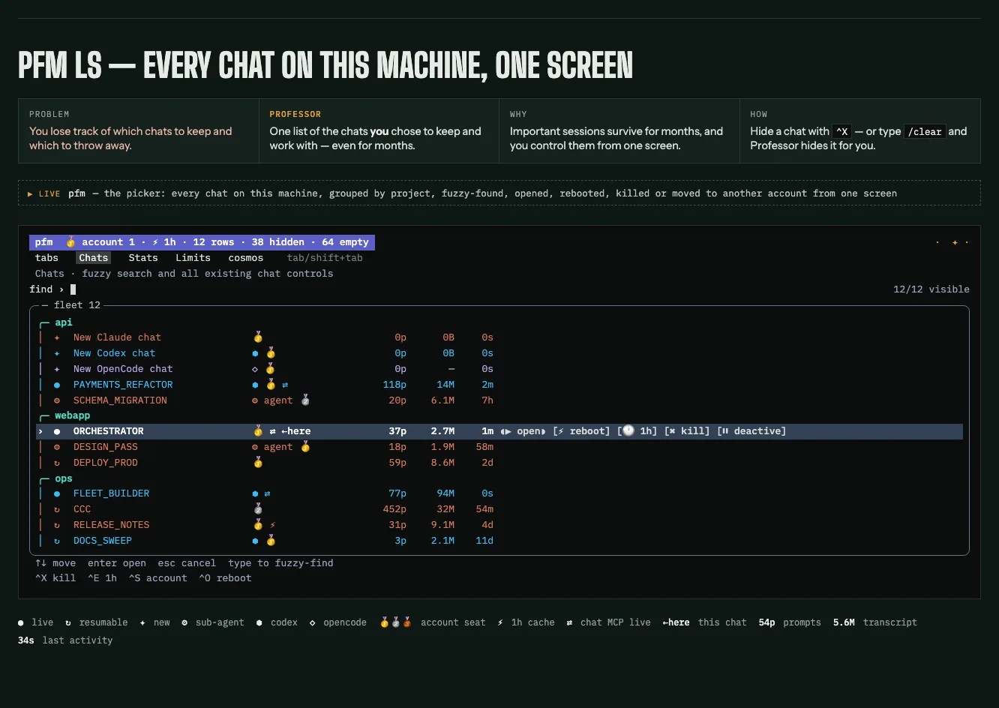
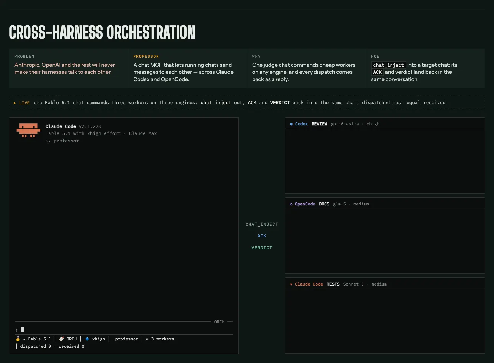
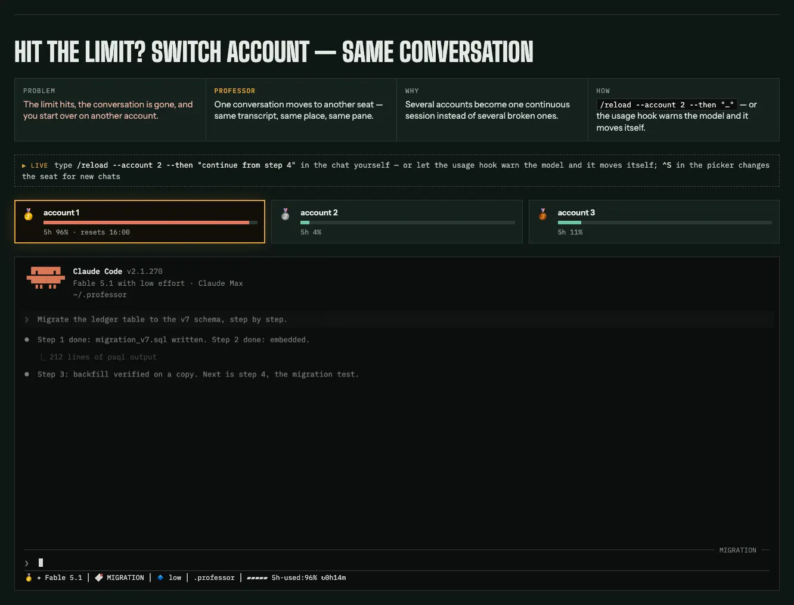

<h1 align="center">Professor</h1>

<p align="center">
  <strong>Run ten agents with the attention of one.</strong>
</p>

<p align="center">
  One workspace for your Claude Code, Codex and OpenCode chats:<br>
  every chat on one screen, chats that call each other,<br>
  one theme and one rulebook across all of them.
</p>

<p align="center">
  <a href="https://github.com/rezzminator/professor/releases"></a>
  <a href="LICENSE"></a>
  
  
</p>

<p align="center">
  <a href="#quickstart">Quickstart</a> ·
  <a href="#watch-it-work">Watch it work</a> ·
  <a href="docs/guide/_index.md">Guide</a> ·
  <a href="docs/guide/plugins.md">Plugins</a> ·
  <a href="https://github.com/rezzminator/professor/discussions">Discussions</a>
</p>

<p align="center">
  
</p>

<p align="center">
  <em>Professor owns none of these tools. It joins the ones you already run.</em>
</p>

## Why Professor?

You already run more than one AI coding chat. They cannot see each other, each tool looks and behaves its own way, and the rules you wrote fade as a long conversation gets summarised.

| | Without Professor | With Professor |
| --- | --- | --- |
| Many chats, many accounts | Scattered terminal tabs; a closed tab is a lost chat | One picker: every chat on every engine, live or resumable |
| One chat needs another | You copy and paste between windows | One chat calls another, across engines, and gets the answer back |
| Editor, panes, terminal, agent | Four tools, four looks, four ideas of what is running | Change the theme once: tmux, Herdr and VS Code follow Claude Code within a second, and a finished chat is marked done on its tab and in the list |
| An account hits its usage limit | Start over in a new chat | The same chat moves to your next account: same pane, same history |
| Your rules, late in a long chat | Whatever the prompt still remembers | Hooks that refuse the action and name the right way |

## Quickstart

Linux or macOS, with `tmux`, `git`, `jq`, `python3` and `zsh` installed.

```bash
curl -fsSL https://raw.githubusercontent.com/rezzminator/professor/main/scripts/install.sh | sh
pfm install          # preview: lists every file it would write, writes nothing
pfm install --yes    # apply
pfm                  # the picker: every chat on this machine
```

The first line downloads the latest released `pfm`, one Go binary, checks it against the release's `SHA256SUMS` and puts it in `~/.local/bin`. Everything `pfm install` writes stays under your `$HOME`.

> [!WARNING]
> **Read before opting in:** `pfm` defaults Claude to bypass mode and Codex to approval bypass; machine and per-account configuration can select the prompted posture.

A machine with a logged-in Codex needs one more step first, and VS Code, Herdr, a source build and the uninstall each have their own section: [INSTALL.md](INSTALL.md). Coming from an older version: [UPGRADING.md](UPGRADING.md).

## Watch it work

Every recording below is real output from this repository, redacted only of names.

### Every chat on one screen

<p align="center">
  
</p>

`pfm` lists every Claude Code, Codex and OpenCode chat on the machine, across accounts, grouped by project: live, resumable or run by an agent. Pick one and you are in it; a chat whose tab you closed is still there. [More on the picker](docs/guide/fleet-cli.md#see-the-fleet).

### Chats that call each other

<p align="center">
  
</p>

A Claude chat hands a review to a Codex chat and a docs task to an OpenCode chat, and each answer comes back into the chat that asked. Every message is signed with its sender, and a message with no known sender is refused. [How a call works](docs/guide/fleet-cli.md#chats-that-talk-to-each-other).

### Hit a limit, keep the conversation

<p align="center">
  
</p>

At 96% of an account's usage window the chat is warned, finishes the step in hand and restarts itself on your next account, in the same pane with every earlier turn still there. [Limits and reload](docs/guide/fleet-cli.md#reload-without-losing-the-conversation).

### Rules that refuse

A sub-agent tries to run `git commit`. A hook answers before the command runs:

```text
git-guard blocked `git commit -m wip`.
Only gitter writes this: spawn Agent(subagent_type: "gitter") with the repo path and the exact change. Never retry, rephrase, split or wrap the denied command to get past the guard.
```

The refusal names the right way, so the agent takes it instead of trying again. [The rules and the agents behind them](docs/guide/discipline-layer.md).

## Also in the box

| | What it is | Read more |
| --- | --- | --- |
| The discipline layer | Agents, commands, hooks and rules you scaffold into your own repository through an interview | [Guide](docs/guide/discipline-layer.md) · [Setup](docs/SETUP.md) |
| Harvester | Fetches the pages that turn AI tools away, and reports a block as a block, never as an empty page | [Guide](docs/guide/plugins.md#read-what-the-web-hides-from-bots) |
| engine-sync | Write your project rules once for Claude Code; Codex and OpenCode get generated copies, checked for drift | [Guide](docs/guide/plugins.md#one-contract-three-runtimes) |
| Ten Claude Code plugins | Each installs on its own: compaction that keeps your facts, live prompt-cache and effort control, per-agent tool and rule visibility, a call meter | [Guide](docs/guide/plugins.md#plugins) |
| The rest of `pfm` | The limits tab, headless runs, token accounting, the VS Code extension | [Guide](docs/guide/fleet-cli.md) |

## Help and community

Questions and ideas go to [Discussions](https://github.com/rezzminator/professor/discussions), bugs to [an issue](https://github.com/rezzminator/professor/issues/new/choose), vulnerabilities privately through [SECURITY.md](SECURITY.md); [SUPPORT.md](SUPPORT.md) has the details.

## Contributing

Work lands on `develop`; `main` moves only by release. [CONTRIBUTING.md](CONTRIBUTING.md) carries the build, the gates and the rules of a repository whose files ship into other people's agent pipelines. Pull requests are welcome.

## Origin

Extracted from a live production monorepo, not designed in the abstract: every rule here exists because something went wrong without it. Built by [@rezzminator](https://github.com/rezzminator).

## License

[MIT](LICENSE)
