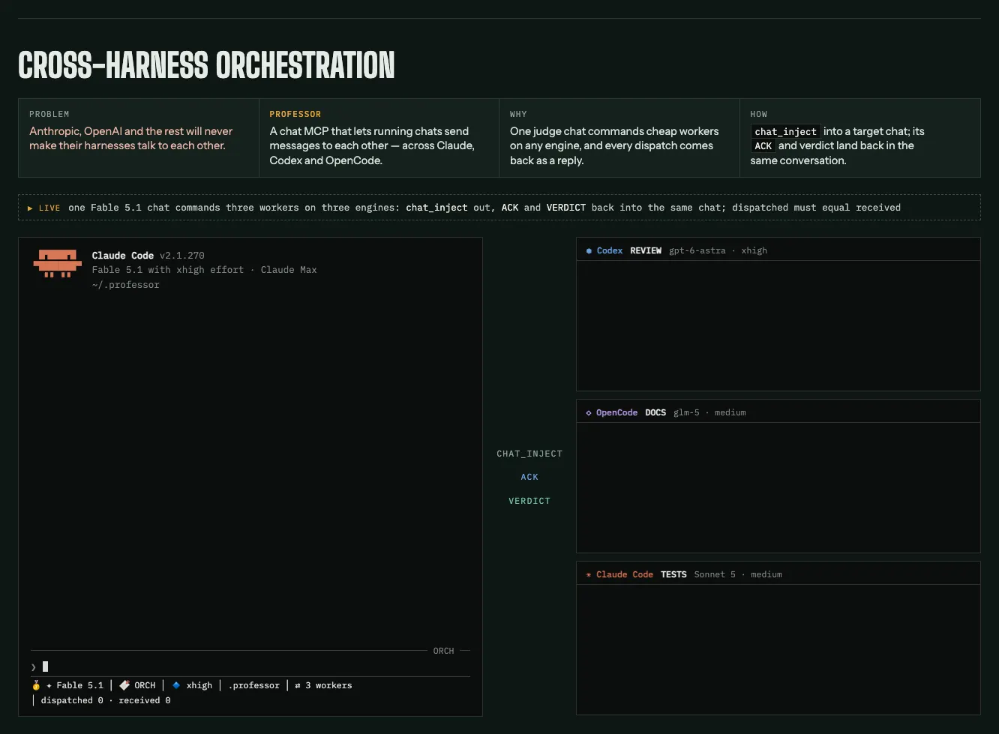
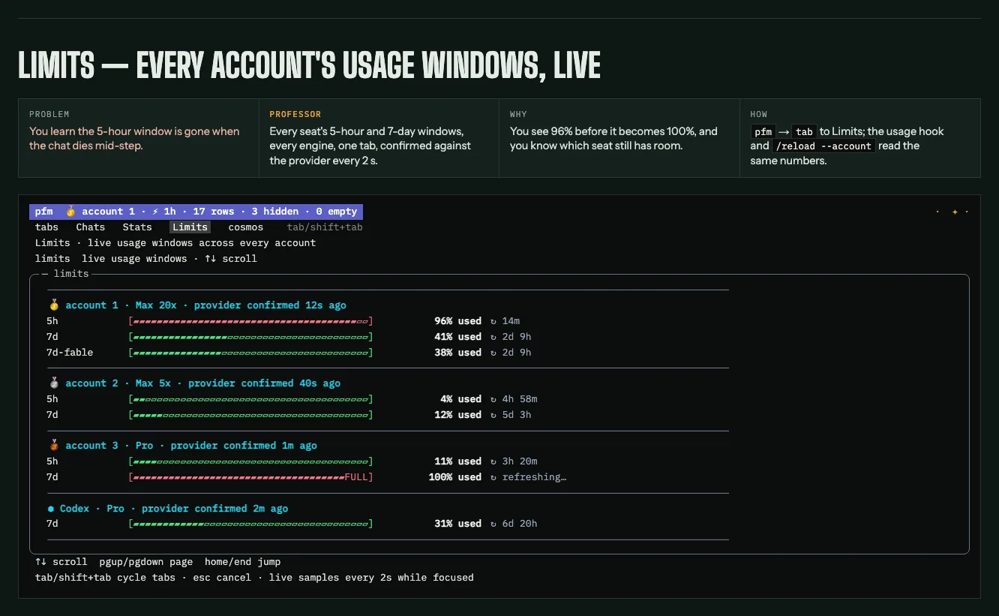
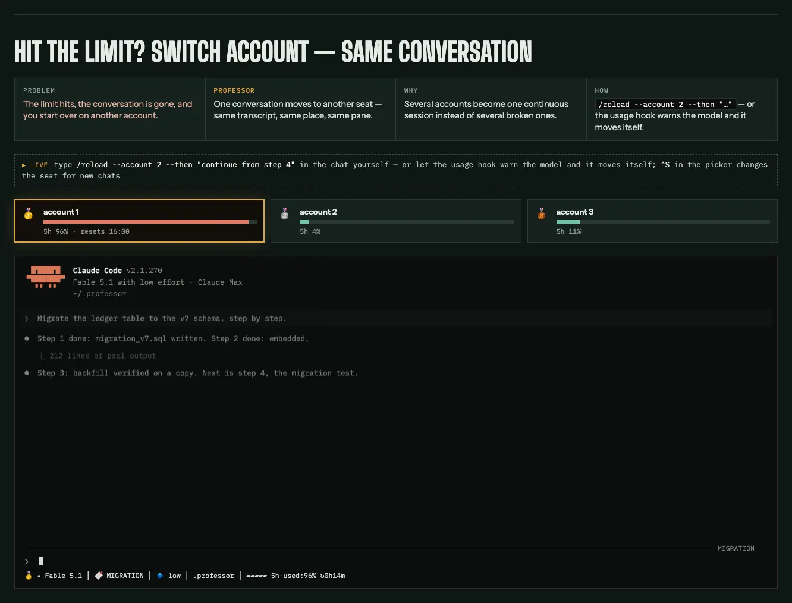

# The fleet CLI (`pfm/`)

One Go binary with embedded installer assets. Beyond the moments on the README:

- **Limits, honestly.** The `Limits` tab shows every provider window on the box; a provider it cannot reach never renders as a 0% bar — the panel says `no usage source registered` instead.
- **Crash-safety by construction.** `reap`, `archive`, `heal`, and `install` default to a dry run, and the dry run **is** the apply's preview. `heal` backs up the store before it deletes a row.
- **Headless exec.** `pfm headless exec` is one scriptable interface for Claude and OpenCode; `--engine codex` also routes to OpenCode. Prompt, system prompt, schema, and timeout go in; normalized results or native streams come out. See [headless README](../../pfm/internal/headless/README.md).
- **Housekeeping.** `doctor` runs the dependency registry and fleet DB checks; `tokens` attributes spend per agent from the telemetry ledger and the transcripts (ledger totals sum telemetry observations that can overlap, never a count of unique calls; telemetry with no session is kept apart from every chat, never guessed into one; transcript totals miss background calls such as `auto_mode` and `prompt_suggestion`, which only the telemetry ledger sees; and prices default to direct/global Claude list rates, so a Bedrock or Vertex setup sets its billing route in `pfm.prices.json`); `/context-audit` rebuilds and prices what each loop loads before its first tool call; `statusline` renders identity, session and spend; the mirrors' single writer is `engine-sync`, which the plugin hooks and `pfm install` run.
- **Editor.** `pfm install --vscode` installs the Professor VS Code extension — visible as **Professor** in the Extensions view and a **Professor** entry in the terminal `+` dropdown — and makes the `PFM` settings profile (its own icon and colour) the default, so each new integrated terminal opens at the fleet picker. To open a Professor terminal, press Ctrl+Shift+Alt+T (macOS: Cmd+Shift+Alt+T), run **Professor: New Chat Terminal**, or pick **Professor** from the terminal `+` dropdown — all three give the next icon and colour; the default `+` terminal is `PFM`. On a prompt file (`SKILL.md`, an agent, a command, `CLAUDE.md`, `AGENTS.md`; setting `professor.promptLint.globs`) the **Prompt Lint** link above line 1 of the file (it reads "Prompt Lint… Ns · Cancel" while a run goes; the palette's **Professor: Prompt Lint** does the same) has Claude, on your own subscription through `pfm headless exec`, check the editor's text against Professor's prompt law (`/law:prompt`, built into the extension's system prompt by `pfm install`); its errors, warnings and info land in the Problems panel, each suggested rewrite a quick fix.

**Requirements** — Linux or macOS, `tmux`, Go 1.27.1+ for source builds

From `pfm doctor`'s own registry: Linux or macOS, `amd64` or `arm64`, plus `tmux` ≥ 1.8, `git`, `python3` (checked, never installed by `pfm install`), `sh`, `bash`, `zsh`, and `sleep`; `setsid` on Linux, `ps`/`lsof`/`launchctl`/`security` on macOS. A clone host also needs the [engine-sync binary](plugins.md#plugins). Go **1.27.1 or newer** for source builds and `pfm update`. The `claude` and `codex` CLIs are optional diagnostics. Themes can be skipped with `--skip-themes`; the Codex probe with `--skip-engine codex`. Run the [dry preview](../../INSTALL.md#preview-plugin-setup-and-optional-components) before applying. Harvester's native install routes, configuration and testing are documented in its [plugin guide](../../plugins/harvester/README.md).

## See the fleet

> `pfm ls`: every AI chat on the machine — Claude Code, Codex (⬢), and OpenCode — across accounts (🥇🥈), grouped by repo, live (●), resumable (↻), or agent-run (⚙). `⇄` marks chats that talk to other chats; `←here` is the one you are sitting in; `✦` opens a new one on any harness. Pick one, attach, or fire it a goal without ever attaching. A chat that scrolled off a closed terminal tab is not gone — it is a resumable transcript, and now somebody can find it.

`tab` once more and the same fleet is drawn as the sky at the top of this page.

> Every project is a star its chats orbit; a spawned chat rises as a moon at its parent's angle, so lineage is visible in the sky itself. When chats talk to each other the sky draws an edge between them, read from a durable comms ledger — an edge is a fact, not a guess. The chronoscope replays the last 24h, and a chat that is dead now still renders as the ghost it was back then.

## Chats that talk to each other

Two panes, two harnesses. You type one line into the Claude chat on the left; the Codex chat on the right receives it as a signed turn and gets to work.

> The footer on the Codex side is the signature: who spoke (`sid 0a98b7fe`) and the exact command to answer them. A message no sender could be derived for is refused, never delivered anonymously.

`pfm chat call` is what the Claude chat called — it types a real, signed turn into another chat's pane — under a per-target lock, safe against a busy target (`--force-now`) and shell-hostile payloads (`--file`). `pfm chat ask` waits for the answer, with named exit codes: `0 done · 2 usage · 3 chat dead · 4 no such chat · 5 answer timed out · 6 message not delivered · 7 answered, but another message reached the chat mid-wait`. The chat family is registered as `chat-professor`, with bare MCP tool names such as `call` and `ls`, so an agent can spawn, message, read, and retire other chats across all three harnesses.

## Reload without losing the conversation

Every seat's windows on one tab, confirmed against the provider every two seconds — you see 96% before it becomes 100%:

Account 🥇 is at 96% of its 5-hour window. The usage hook warns the chat mid-task; it finishes the step in flight and moves the conversation to 🥈 itself — same pane, same history:

> The red banner is the usage hook — it reaches the model before the limit does. `/reload` typed by a human goes through a hook too, before the model sees it, so the reboot never spends a turn.

The running chat reboots in place — same pane, same history, new account, model, or effort. `--then "prompt"` hands the baton unattended; `/reload` typed by a human runs through a hook without spending a model turn; `/handoff --branch` carries the full context into a detached successor.
