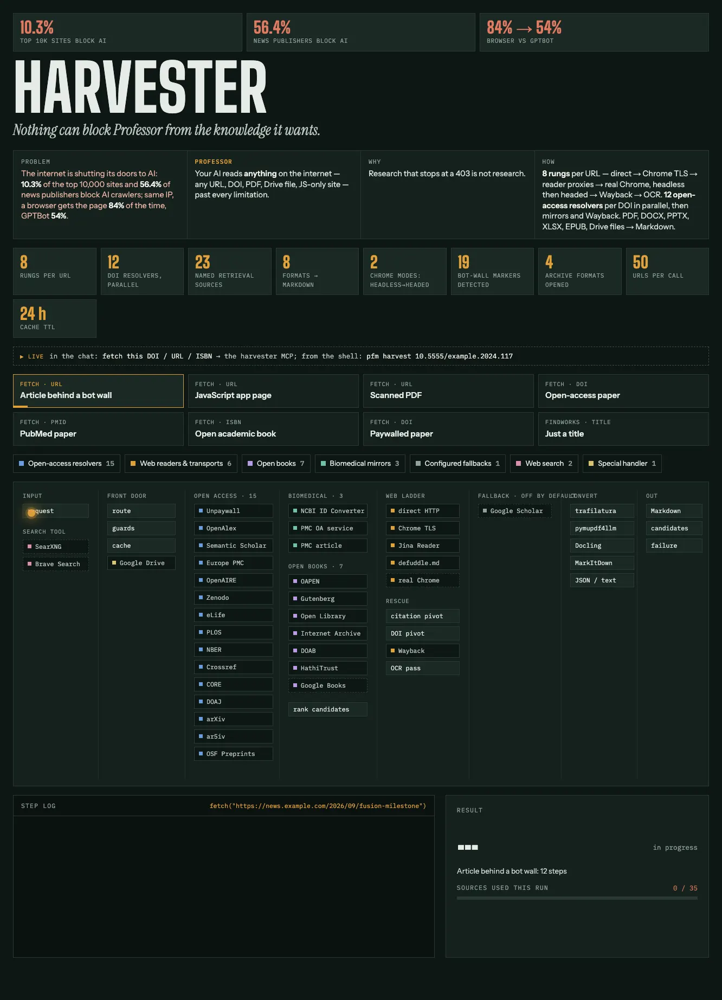

# Plugins

Claude Code plugins built with Professor, installable on their own. This repo is their marketplace:

```bash
claude plugin marketplace add rezzminator/professor
claude plugin install forward-compaction@professor
```

- [forward-compaction](https://github.com/rezzminator/forward-compaction): the model writes its own handoff through one tool and the plugin installs it at Claude Code's compaction, with facts recorded from typed events and every later message kept verbatim. It replaces the earlier `sub-agent-compact` plugin, whose settings it no longer reads (its CHANGELOG maps each one).
- [cache-live-control](https://github.com/rezzminator/cache-live-control): a `/cache` command that switches the prompt-cache TTL (5m, 1h or automatic) for one chat and its sub-agents, live, with no model turn.
- [auto-effort](https://github.com/rezzminator/auto-effort): reasoning effort for the main chat and for the sub-agents it launches. Each main-chat turn starts at a planned level, the model raises or lowers it with a `set_effort` tool, failing tests raise it, and a per-model cache check switches it off where an effort change would break the prompt cache. Start the Agent prompt with `[effort: low|medium|high|xhigh|max]` to set a sub-agent's effort per spawn; an agent whose frontmatter opts in with `effortControl` has its effort rise at each failing test run or red sub-task and come home once the trouble resolves. It replaces the earlier `auto-effort-control` and `effort-live-control` plugins, carrying their settings over (its README and CHANGELOG state the migration).
- [tool-visibility-controller](https://github.com/rezzminator/tool-visibility-controller): one `visibility` field in agent, skill and command frontmatter decides, per agent, which sub-agents, skills, MCP tools and built-in tools it sees and may call — hidden from the listing and refused, never just discouraged.
- [rule-control](https://github.com/rezzminator/rule-control): one `visible-to` key in a rule file's frontmatter names the loops that receive the rule — the main chat, chosen agent types (globs allowed), or all; a targeted rule leaves the context every loop shares and reaches only those loops, again after each compaction. Claude Code only: engine-sync still carries such a rule to every Codex and OpenCode loop.
- [flights](https://github.com/rezzminator/flights): a codebase map for the agents that build and land work — the main chat at session start, and each flights foreman or lander as it starts, gets ponytail's symbol map, ported: one line per source folder naming the functions, classes and types its files export, within 2,000 characters, cached per commit; in a flight worktree it lists only the folders that flight changed; when the map cannot be built, the line says why. Claude Code only; the plugin also ships the flights agents (`flights:foreman`, `flights:lander` and their children), `/flights:spec`, `/flights:doctor` and the `flights:lander-inventory` skill.
- [buddy](https://github.com/rezzminator/buddy): a tiny ASCII companion above your prompt — Quack the duck, seven more characters or your own — that comments on each turn, suggests your next prompt and answers `/buddy` questions from what it remembers of the chat.
- [callmeter](https://github.com/rezzminator/callmeter): records every tool call, model request, sub-agent turn and session event into one local SQLite store — counts and sizes, never your prompts or file contents — and answers which files, commands and agents cost the most.
- [engine-sync](https://github.com/rezzminator/engine-sync): carries a project's Claude Code agents, commands, skills and MCP servers to Codex and OpenCode — `AGENTS.md`, `.codex/`, `.opencode/` and the role TOMLs in each Codex home — and keeps them in step after every turn; at `pfm install`, `engine-sync global` also carries the always-on global rules of `~/.claude/rules/` to both engines; run it as `engine-sync codex ...` and `engine-sync opencode ...`.
- [cache-keepwarm](https://github.com/rezzminator/cache-keepwarm): keeps the main chat's prompt cache warm while it waits on background agents, shells, Monitors and workflows — one invisible replay before expiry, admitted only while the forecast spend stays under the rewrite it saves; `/keepwarm on|off|status` controls it.

`pfm install` ensures the plugins `claude.plugins` in `pfm.config.json` lists; unset, that is cache-live-control, forward-compaction, auto-effort, tool-visibility-controller, engine-sync and flights. A bare name is one of ours, installed as `{plugin}@professor` on every build. A release build installs it from this repo's marketplace, `rezzminator/professor`. An alpha build of pfm installs it instead from a local checkout: the working tree of `{plugin}/plugins/{plugin}` under the source clone's `plugins/`, where each plugin is a git submodule on its `develop` branch (`git submodule update --init`), or under the directory `claude.pluginCheckoutRoot` in `pfm.config.json` names, which wins when set: it copies each into `~/.local/share/professor-dev/plugins/{plugin}`, lists it in that directory's own marketplace, also named `professor`, and installs `{plugin}@professor` from there. An alpha build also installs every other plugin the source clone's `.claude-plugin/marketplace.json` lists the same way, so `claude.plugins` is the enabled set: a listed plugin is enabled, and one the list does not name is installed from its checkout and disabled. A plugin with no checkout is not installed on an alpha build, never from GitHub, and the line names the root it tried; for a listed one that is a failure. Unset on an alpha build, the list is every plugin the marketplace lists, all enabled; a release build's default stays the six above. The install re-points a `professor` marketplace Claude Code knows from another source with `claude plugin marketplace add`, never automatically removing it. A printed manual repair may require `claude plugin marketplace remove`; it deletes the plugins' saved options and data, so run it only if they may go. A plugin installed under an older id, `{plugin}@{plugin}` from its own GitHub marketplace or `{plugin}@{plugin}-dev` from `~/.local/share/{plugin}-dev`, moves to `{plugin}@professor` once that is installed: its `pluginConfigs` options are copied over, each old install is uninstalled with its data kept (one in a project scope is first installed as `{plugin}@professor` in that project), the old marketplace is removed once nothing is installed from it, `~/.local/share/{plugin}-dev` is deleted, and any old key left in `enabledPlugins` or `pluginConfigs` is dropped; `pfm doctor` names each old copy left. The install builds an enabled callmeter's binary from its checkout into `{callmeter home}/bin/{version}/callmeter` before refreshing its copy, keeping the binary it replaces as `callmeter.prev`. Claude Code reads an alpha checkout copy straight from its folder (`readFromFolder` in `claude plugin list --json`; `claude plugin update` answers that there is nothing to update), never from its versioned cache, so a checkout edit, committed or not, reaches a new chat or an open chat's `/reload-plugins` with no version bump, and a running chat's next hook call can already run newly mirrored files. The install also runs `claude plugin update` for each `plugins/installed_plugins.json` entry behind the checkout's `plugin.json` version. On a release build Claude's versioned cache is what runs: a content change ships with a version bump, and an open chat gets it when it restarts. A listed plugin the install leaves off its checkout copy or disabled is a `FAIL` line naming the plugin, the account dir and each cause, the summary line counts it as `failed=N` and the install exits non-zero; `pfm doctor` reports the same as `FAIL`, and fails when the callmeter binary the install placed is gone. A full `name@marketplace` id is installed as named, from Claude Code's own marketplace of that name when it knows one; an entry `{"id": "name@marketplace", "source": "owner/repo"}` adds the marketplace first (`source` is what `claude plugin marketplace add` takes: `owner/repo`, a git or https URL, a path). An id with neither is reported by name, with its repair, in install and doctor. A plugin neither the list nor, on an alpha build, the marketplace names is never touched in any `settings.json`.

A plugin option is also an environment variable named `{PLUGIN}_{OPTION}`: the plugin's name and the option in upper snake case, as in `AUTO_EFFORT_FLOOR`. The variable beats the option, which beats the default. Two plugins differ: forward-compaction has no options and reads its settings from these variables alone, as in `FORWARD_COMPACTION_CEILING`; buddy reads none and keeps every setting in its own file, `${XDG_CONFIG_HOME:-~/.config}/buddy/config.json` (its README). `claude.env` in `pfm.config.json` maps each variable to its string value, and `pfm install` writes the map into the selected config directory's `settings.json` `env` (the primary account by default, normally shared through the accounts' links). Doctor checks the last successful install's recorded target, including `--config-dir`. pfm owns only the variables it wrote, recorded in `~/.local/share/pfm/install/claude-env-ownership.json`: a variable dropped from `claude.env` is removed unless it was changed by hand since, and one pfm never wrote is left alone. Alpha installs default an unset `PLUGIN_LOG_DIR` in each managed account directory to the shared `~/.local/state/pfm/plugin-logs` folder, or the absolute path set by `claude.env.PLUGIN_LOG_DIR`; an operator-set value is neither overwritten nor taken into ownership. Release installs and uninstall retire generated settings only while they remain pfm-owned, never deleting the logs. A chat writing that settings.json while pfm edits it keeps its write: pfm reads the file again just before replacing it and plans its edit again on what it finds, at most three times, then fails naming the file — rerun `pfm install`. Apart from the known `PLUGIN_LOG_DIR` knob, a variable no installed plugin's name prefixes is a warning. `claude.env` may not set the launch-owned `CACHE_LIVE_CONTROL_MAIN_TTL`, `CACHE_LIVE_CONTROL_AGENTS_TTL`, `CALLMETER_HOME` or `ENGINE_SYNC_HOME`; every launch sets the main cache TTL from `claude.cache1h`. `pfm doctor` fails a variable missing or different from `claude.env`, and one left behind after its removal.

`pfm install` installs no engine-sync, and on any host with a Professor clone (the discipline-layer clone above, every `pfm update` host) or a Codex home it refuses without the binary, naming the missing path; a binary-only install with neither skips the step. So install the plugin before the first `pfm install --yes` or `pfm update`: `claude plugin marketplace add rezzminator/professor`, then `claude plugin install engine-sync@professor`, then start a new Claude session. At that session start its wrapper downloads the release binary, checks it against the plugin's `SHA256SUMS`, and links it at `~/.local/share/engine-sync/bin/engine-sync`, the binary the plugin's hooks run; `test -x` on that path confirms it. Once that binary exists, `pfm install --yes` links it onto PATH as `~/.local/bin/engine-sync` (an existing entry there that is not pfm's link stays untouched, and `pfm doctor` warns).

## Read what the web hides from bots

About one in ten of the world's top 10,000 websites now tells AI crawlers to stay out — among news publishers, more than half (HasData AI Crawler Block Index, July 2026). Harvester fetches the way a reader's browser does and climbs a seven-rung ladder — direct → Chrome-fingerprint TLS → reader proxy → extractor → headless-then-headed browser → Wayback → OCR — until it holds real content:



A block is reported as a block and an app shell is never stored as the page — a failure names every source it checked, never an empty success. DOIs, ISBNs, PMIDs and PMCIDs route through twelve open-access resolvers in parallel; `harvester ask -p "…" <sources>` feeds the full cached artifacts to a Claude or Codex ask engine, failed sources kept visible as receipts. Harvester is a standalone Go plugin in `plugins/harvester/`. Its native engine plugins register the `harvester` MCP server and launch `harvester mcp` as a stdio proxy to the persistent daemon; the [plugin guide](../../plugins/harvester/README.md) lists each engine's measured tool names and install route. The browser rung never solves anything interactive.

## One contract, three runtimes

```text
$ engine-sync codex build .
$ head -1 AGENTS.md
<!-- Generated by engine-sync from CLAUDE.md — edit the source, then run: engine-sync build -->
$ engine-sync codex check .
CODEX CHECK PASS
```

`CLAUDE.md` compiles to `AGENTS.md`; `.claude/**` compiles to `.codex/**` and `.opencode/**`; global agents' `.toml` roles compile straight into `~/.codex/agents/` as regular files — Codex opens a role with `O_NOFOLLOW` and refuses a symlink, so a link there is a role that cannot spawn. Every mirror is generated, never tracked — a fresh clone has none of them until its compiler runs. The Stop hook recompiles the mirrors and a drifted mirror fails the check, so the three harnesses can never disagree about the law. Even the verification engine is one TypeScript source compiled for both the Claude Workflow runtime and the Codex SDK.
